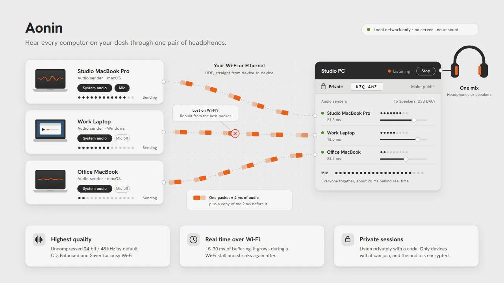

# Aonin

Stream audio from multiple computers to one output.



Aonin streams audio between computers on the same local network. One computer is the **listener**. The others connect as **audio senders**, streaming system audio, microphone input, or both. The listener mixes the incoming streams and plays them through one audio device.

Aonin runs on **Windows and macOS** from the system tray or menu bar. It supports English, Bahasa Indonesia, French, Spanish, and Simplified Chinese.

- **Local network only.** Devices discover each other over the LAN without servers or accounts. Audio stays on the local network.
- **Uncompressed audio by default.** Streams use 24-bit / 48 kHz PCM, with lower-bandwidth options including CD 16-bit and Opus Balanced / Saver for weaker networks.
- **Real-time streaming over Wi-Fi.** Typically 15–30 ms of buffering, with redundant packets and retransmissions to reduce dropouts caused by packet loss.
- **No drivers required.** Aonin captures system audio using WASAPI loopback on Windows and the Core Audio process tap on macOS 14.2+.

> **Status:** Aonin is in early development. Core audio streaming works, while other features are still in development. See the [Roadmap](#roadmap) for details. Installers are available on [Releases](https://github.com/rosydaqbar/aonin/releases).

## Aonin Pro

Aonin is free. Aonin Pro adds private listeners and lets you transfer the listener role to another device. Android and iOS apps are planned.

More on [lfg.ink/aonin](https://lfg.ink/aonin).

This repository contains the free version's source code.

## How it works

```
 MacBook ──┐
 MacBook ──┼── Wi-Fi / Ethernet (UDP, LAN only) ──► Listener ──► headphones / speakers
 Laptop  ──┘
```

- **Discovery:** Each running instance of Aonin broadcasts a small beacon on the LAN once a second. Available listeners appear automatically. Private listeners are hidden from the list.
- **Transport:** Audio is divided into 2 ms blocks. Each packet also contains the previous block. This lets the receiver recover a single lost packet from the next packet without additional delay. Longer gaps trigger NACK requests and retransmissions, up to three times.
- **Jitter buffer:** Each incoming stream has an adaptive buffer that increases to accommodate recent Wi-Fi stalls and decreases when network conditions improve. Clock drift between computers is corrected by resampling a few hundred ppm instead of dropping samples.
- **Loop prevention:** A device cannot join a listener if that connection would create an audio feedback loop, such as a listener sending audio back to the same computer. These listeners remain visible but cannot be joined.

## Platform notes

- **macOS:** Aonin requests permission to record system audio and microphone input. Audio capture remains silent until permission is granted.
- **Local Network access on macOS:** Aonin also requests Local Network permission once. If you missed the prompt, open **Network › Local network access** in Aonin and select **Ask again**. You can also select **Open settings** to enable Aonin under Privacy & Security › Local Network.
- **Windows Firewall:** Windows requests permission for incoming connections the first time a computer acts as a listener.
- **Wi-Fi on macOS:** AirDrop/Handoff (AWDL) can cause brief stalls. The adaptive buffer compensates for these interruptions by adding a few milliseconds of buffering.

## Installing

Download the installer for your operating system from [Releases](https://github.com/rosydaqbar/aonin/releases).

The installers are not code-signed yet, so Windows and macOS may require additional steps during installation.

- **Windows:** SmartScreen may display "Windows protected your PC". Select **More info**, then **Run anyway**. Choose "install for all users" to let the installer allow Aonin through Windows Firewall.
- **macOS:** Open the DMG and drag Aonin into Applications. If macOS prevents it from opening, right-click Aonin in Applications and select **Open**. Alternatively, run `xattr -cr /Applications/Aonin.app`. Grant audio recording permissions when prompted.

Aonin opens its window on the first launch. On subsequent launches, it runs from the system tray or menu bar.

Aonin updates automatically from Releases.

## Languages

Aonin uses your system language by default. To change it, open the window and select a language from the menu above **Quit Aonin**.

UI translations are stored in `app/src/lib/i18n`. The English source is `en.ts`, and each supported language has its own file with matching keys.

To improve a translation or add a language, edit an existing translation file or copy one as a starting point, then open a pull request.

## Building from source

Requirements:

- [Rust](https://rustup.rs) (stable)
- [Node.js](https://nodejs.org) 20 or newer
- [CMake](https://cmake.org) (builds the bundled Opus codec). On Windows the copy in Visual Studio Build Tools works if it is on `PATH`; on macOS, `brew install cmake`
- Windows: Visual Studio Build Tools with the C++ workload (WebView2 ships with Windows 11)
- macOS: Xcode Command Line Tools, macOS 14.2 or newer

```sh
cd app
npm install
npm run tauri dev     # run the app
npm run tauri build   # installer: .exe / .msi on Windows, .app / .dmg on macOS
```

### Command-line tool

The audio engine also includes a CLI for testing without the desktop app:

```sh
cargo run --release -p aon-cli -- devices             # list audio devices
cargo run --release -p aon-cli -- hub                 # receive, mix and play
cargo run --release -p aon-cli -- send 192.168.1.20   # send this machine's system audio to a hub
cargo run --release -p aon-cli -- send 192.168.1.20 --source mic
```

### Project layout

| Path | What |
| --- | --- |
| `crates/aon-core` | Platform-independent core: wire protocol, jitter buffer, resampler |
| `crates/aon` | Audio I/O (cpal), UDP sender and hub, discovery, listener and audio sender engine, license check |
| `crates/aon-pro` | Hook for Aonin Pro; in this repo a stub, so Pro features stay locked |
| `crates/aon-cli` | Command-line tool for testing (`aon`) |
| `app` | Desktop app: Tauri 2 shell (tray, popover, window) and the Svelte UI |
| `app/src/lib/i18n` | UI text in every language |
| `app/icons-src` | Icon sources (SVG) |

Run the tests with `cargo test`.

## Roadmap

- **Done**
  - Real-time audio streaming on Windows and macOS without drivers
  - Two-way audio
  - Quality tiers
  - Automatic updates
  - Five languages
  - Aonin Pro
- **Next**
  - Sign in to connect your own devices without a code
  - Android and iOS apps
  - Native macOS design
  - Code-signed installers

## License

Aonin is free software, released under the [GNU General Public License v3.0](LICENSE) or (at your option) any later version. You may use, study, share and modify it; if you distribute a modified version, it must stay under the same license with its source available.

